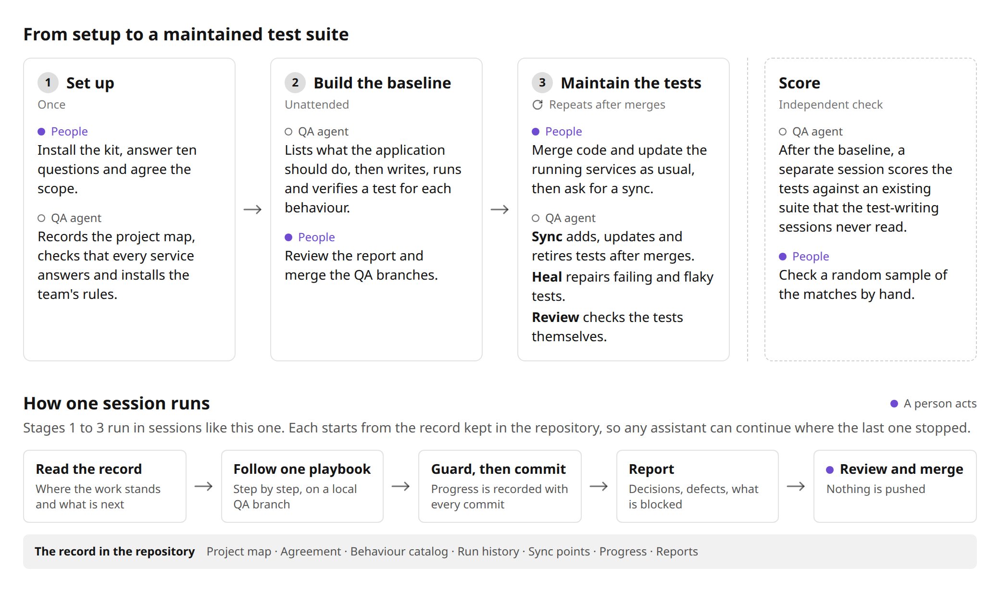
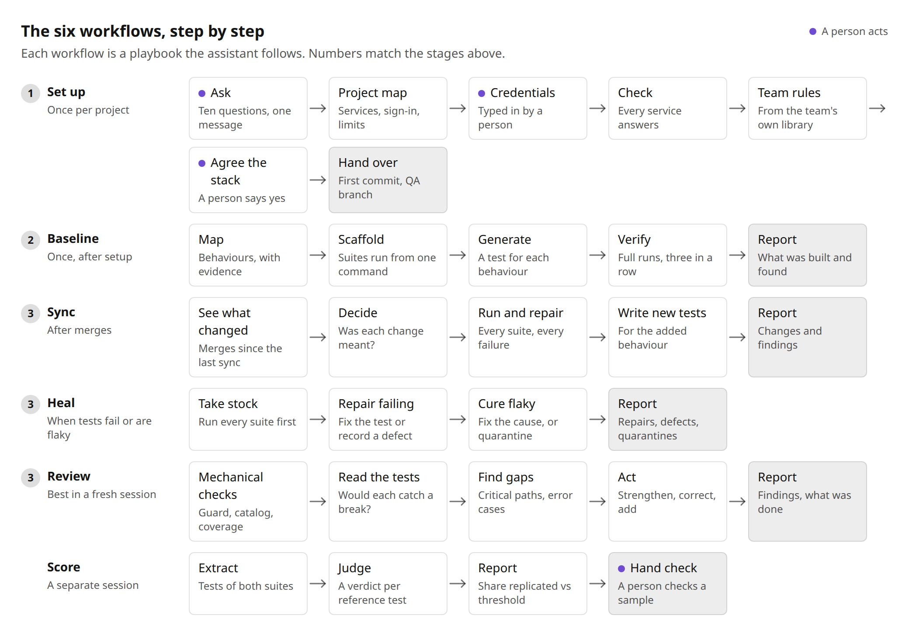
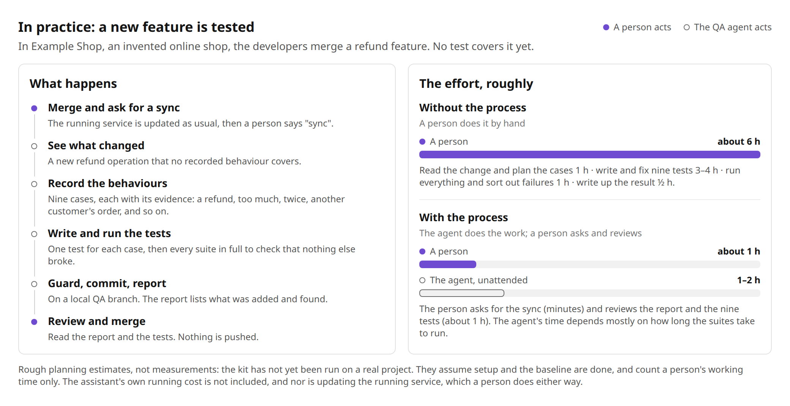
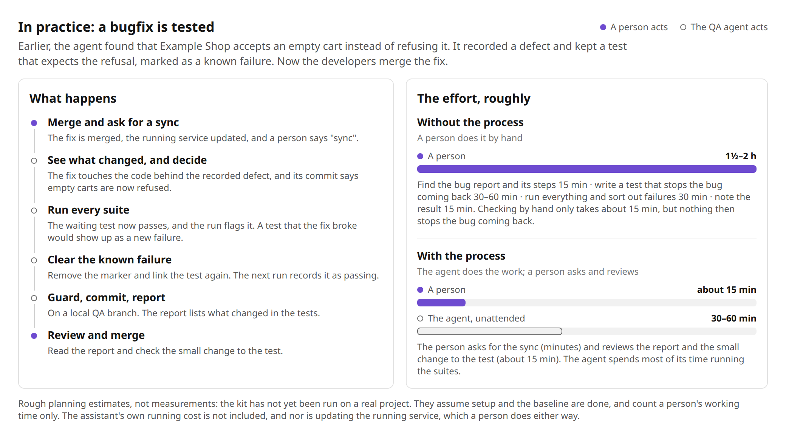

# QA agent kit

A QA agent that any coding assistant can be. The kit is a manual, six playbooks, test-writing methods and a small helper program. It is installed into the repository that holds a project's tests; an assistant opened there (Cursor, Claude Code, Codex, Grok, Gemini CLI, …) follows it to:

- **set up** once: which services run where, where their code is, how to sign in as a test user, which team rules apply;
- **build the baseline**: map what the application should do, scaffold the test frameworks, write the tests, run them and report. API, integration, end-to-end and application-specific suites go into the test repository; unit and component tests go into each service's own repository;
- **sync after merges**: compare each service with the commit the tests were last brought up to date with, write tests for new behaviour, update tests where behaviour changed on purpose, retire tests for what was removed, and report what changed by accident;
- **heal** failing and flaky tests without weakening them;
- **review** its own suites;
- be **scored**, in a separate session, against an existing test suite it has never read.

Nothing in the kit depends on a particular model or tool. The instructions are Markdown, the state is JSON in the repository, and the helper uses only Python's standard library. The kit holds no project's names, URLs or rules: those are asked for at setup and kept in the test repository.

## How it works



The playbooks behind those stages:



### In practice

Two examples from Example Shop, an invented online shop, each with a rough estimate of the effort with and without the kit. First, a new feature is merged:



Second, a bug that the agent recorded earlier is fixed and merged:



The figures are planning estimates, not measurements. The kit has not yet been run on a real project, so replace them with your own after a first pilot. They assume setup and the baseline are done, and count a person's working time: not the assistant's running cost, and not updating the running service, which a person does either way.

If the agent had not recorded the bug beforehand, the sync treats the fix like any other change: it updates the behaviour and its test, or adds them, citing the fix's commit (`kit/playbooks/sync.md` has the rules).

The same material is in a PDF, one section to a page: [how-the-qa-agent-works.pdf](docs/how-it-works/how-the-qa-agent-works.pdf). Its last page lists what people decide, the limits the agent works under and what the guard checks.

## What it needs

- Python 3.9 or newer and git on the machine. With git 2.38 or newer the helper also recognises, in a service's repository, a QA branch that was merged as one squashed commit; with an older git it takes such a branch for unmerged and continues it.
- An assistant that can read and write files and run shell commands, for hours of test runs and git commands, without a prompt for each one.
- Network access for the tests' package manager and, for end-to-end tests, the browser download.
- The application running, and its repositories checked out on the same machine.

## Install

```
python3 install.py /path/to/test-repository
```

The test repository is either a QA repository for one or more application repositories, or an application's own repository. Install at its top folder. The installer:

- copies `kit/` to `.qa-agent/kit/` and records a hash of every file in `.qa-agent/kit.lock.json`;
- adds a short pointer block to `AGENTS.md` and `CLAUDE.md`, leaving the rest of those files alone (`--also GEMINI.md .github/copilot-instructions.md` adds it to more files, `--no-pointers` to none);
- creates the empty folder `.qa-agent/library-source/`, where you can paste a copy of your team's rule library;
- keeps run output, QA worktrees, that pasted copy, the tests' env file and saved sign-in state out of git, through `.qa-agent/.gitignore` and the clone's own exclude file. The repository's own `.gitignore` gets a block only in a QA repository, once setup has said it is one; an application's `.gitignore` is never touched.

Run it again to update the kit. The project map, the state, the installed team rules, the pasted copy and the reports are never touched.

## Use

Open your assistant in the test repository and say what you want.

| Say | The agent |
| --- | --- |
| "set up the QA agent" | asks its ten setup questions in one message, writes the project map, checks that every service answers, installs your team's QA rules, proposes the test stack |
| "build the baseline" | maps behaviours, scaffolds the suites, writes and runs the tests, reports. No further questions |
| "continue" | picks up wherever the last session stopped, whichever assistant that was |
| "sync" | brings the tests up to date with what was merged since the last sync |
| "heal the failing tests" | diagnoses each failing or flaky test and repairs the test, or records a defect |
| "review the tests" | checks the suites against the kit's own standards and fixes what it finds |
| "add tests for the refund endpoint" | records the behaviours of that one feature, writes and runs their tests |

An assistant that does not load `AGENTS.md` or `CLAUDE.md` by itself needs one sentence more: "Read `.qa-agent/kit/MANUAL.md` and follow it."

After setup the agent does not stop to ask. Where it has to decide something, it takes the cautious option and records it; every report lists those decisions, what it needs from you, and what it could not test and why.

### Have ready for setup

- Every service running, with data that may be tested against, from the checkout you will name. Say so if one runs from something built earlier or elsewhere.
- Each service's repository checked out on this machine, on the branch merged work lands on.
- A test user for each role. The agent asks for the *names* of the environment variables; you type the values into the env file it names (`.env` in a QA repository, `.qa-agent/.env` in an application's own), which is git-ignored and which the agent never opens.
- If signing in needs single sign-on or a second factor: you will be asked to sign in once in a browser the test runner opens, and again whenever that saved session expires.
- Your team's rule library, if there is one: either its path on this machine, or a copy pasted into `.qa-agent/library-source/` (the library's folder or its contents; git ignores the copy). Setup finds a pasted copy by itself. The chosen rules are copied into `.qa-agent/library/` with a hash of each and, where the library is a git checkout, its commit. To take in a newer library later, replace the pasted copy and run `python3 .qa-agent/kit/qa.py library install --refresh`.
- Any folder the agent must never read, such as an existing test suite kept aside for scoring.

### What it will not do

The manual holds the full list. In short: it writes tests, test support and its own state, and nothing else. It never changes application code, never touches a service's checkout (tests for a service are written in a separate working copy on a `qa-agent/…` branch), never pushes or merges, never writes a secret into a file, and never loosens a test to make it pass: a correct test that fails is recorded as a defect, with a report.

`qa guard` checks the mechanical part of this before every commit: where files were written, that service checkouts are unchanged, that no credential value is about to be committed, that no test was switched off without a recorded reason. The guard is a check the agent runs, not a sandbox; see `docs/design.md` for what is enforced and what is instruction.

### Where the work lands

- In the test repository: commits on a local branch `qa-agent/<work>-<date>`, and dated reports in `.qa-agent/reports/`.
- In each service's repository: commits on a local `qa-agent/…` branch, made through a git worktree under `.qa-agent/worktrees/<service>`.

Nothing is pushed. You review and merge.

Until you merge a QA branch, the tests and the agent's records exist only on it. A later QA session continues on that branch by itself. If an assistant finds no QA agent in the repository, the branch you have checked out does not hold `.qa-agent/` yet: check out the QA branch, or merge it.

In an application's own repository the agent shares your working copy. A QA session puts it on a `qa-agent/…` branch; your uncommitted files stay as they are and are never staged or committed by the agent, which writes only under `.qa-agent/` and in the test folders you agreed to at setup.

## Scoring against an existing suite

A reference test counts as replicated when a generated test checks the same behaviour, whatever its name, language or framework. That is a judgement, so the kit splits the work: the helper extracts the tests of both sides and proposes candidates, a judging session records a verdict for every reference test, and the helper counts.

1. At setup, name the reference suite's folder as off limits. Sessions that write tests then never open it.
2. When the baseline is finished, start a **new** session in an empty folder outside both repositories and say: "Follow `<test repository>/.qa-agent/kit/playbooks/score.md`. Reference: `<path>`. Generated: `<test repository>`. Output: this folder. Threshold 80."
3. Read `report.md` there. It gives the replicated share and whether the threshold is met, the same figure with partial matches counted as half, the share covered by tests that passed their last run, a similarity estimate that involves no judgement, a table by area, and a random sample of matched pairs for you to check by hand.

The report and its lists stay in the scoring folder. They are never shown to a session that writes tests: tests written from the answer sheet would make the next score meaningless.

## In this repository

```
install.py          installs or updates the kit in a repository
kit/                what gets installed
  MANUAL.md         the agent's standing instructions and limits
  playbooks/        setup, baseline, sync, heal, review, score
  methods/          how to map a system and write each kind of test; stacks/ has the runners' specifics
  templates/        an example project map, example behaviours, the defect report form
  qa.py, qa_agent/  the helper (Python standard library only)
tests/              the kit's own tests
docs/design.md      why it is built this way, and what it does not do
docs/how-it-works/  the diagrams above: four images, the PDF, and the Cursor canvas they are exported from
```

## Developing

```
uv run pytest
```

The suite covers the helper, runs the whole flow offline against a small sample service (install, setup, baseline, a merge, sync, the guard's refusals, scoring), and checks every command, option and file the kit's documents mention against the helper itself.

## Status

Version 0.1.0. The helper is covered by the test suite above, on Python 3.9 and 3.12. The documents were corrected after a cold read by an assistant that had not seen the kit before. The playbooks have not yet been through a complete run by an assistant on a real project, with any model; expect to adjust them after the first one. `docs/design.md` lists the known limits.
